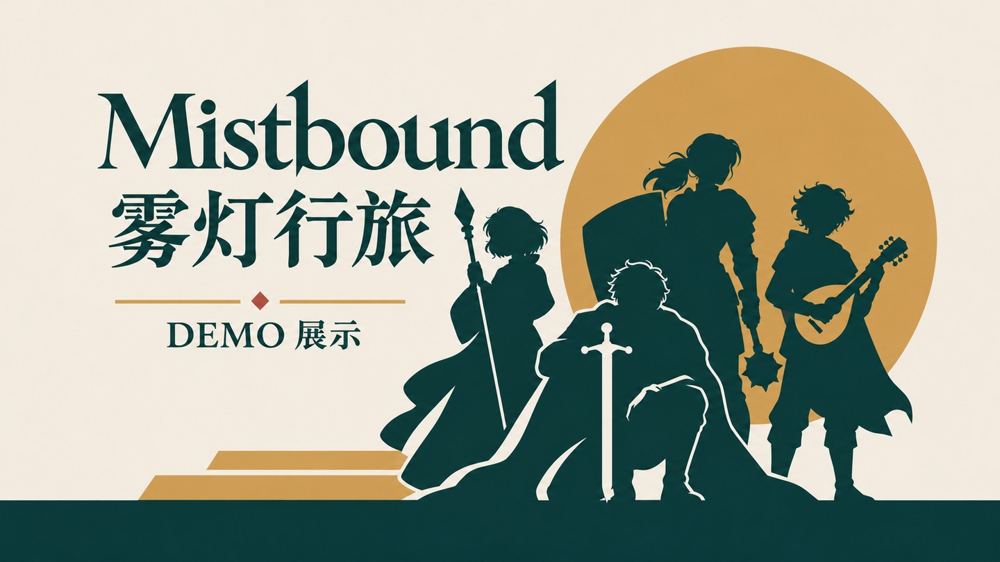
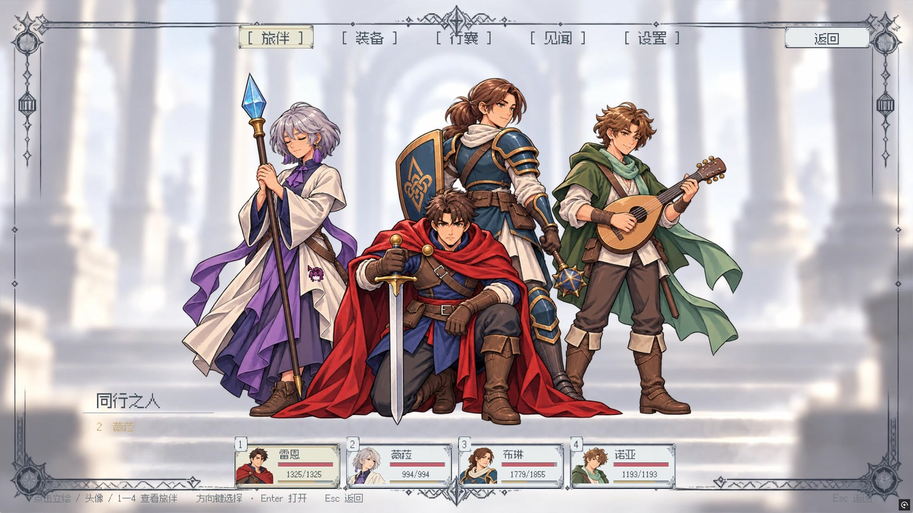
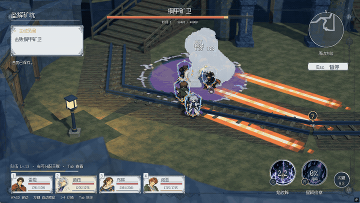
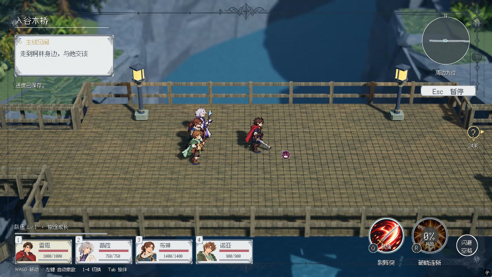
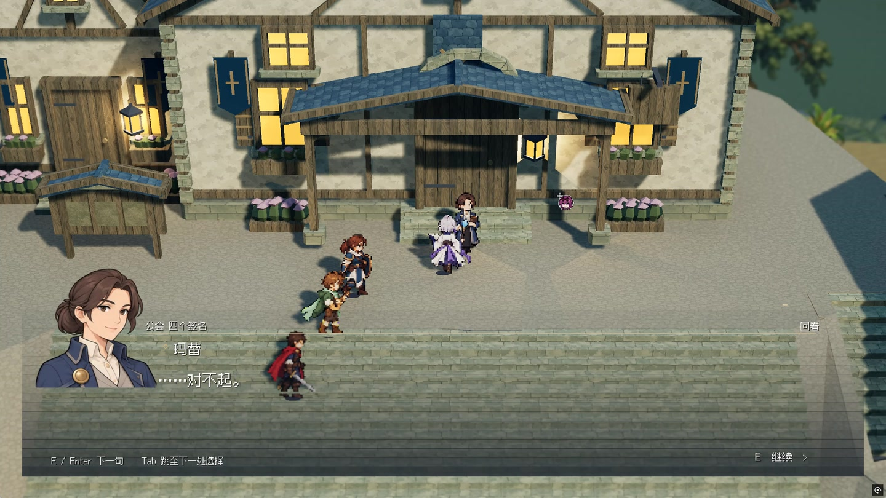
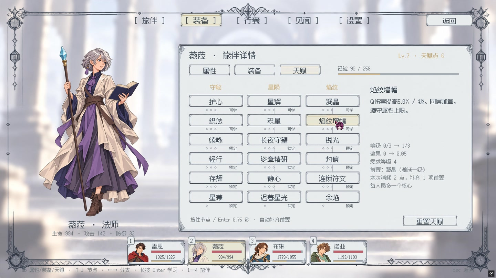
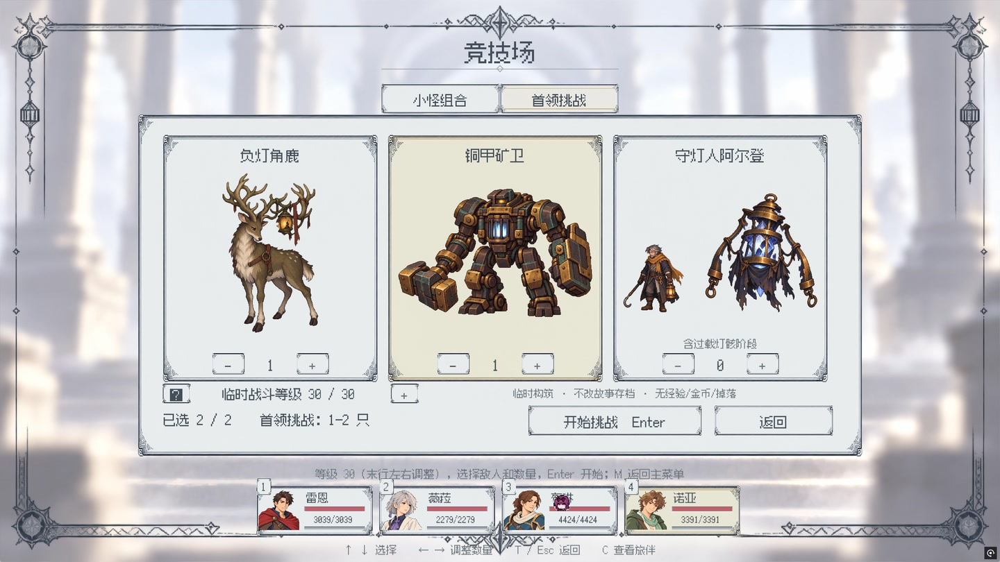
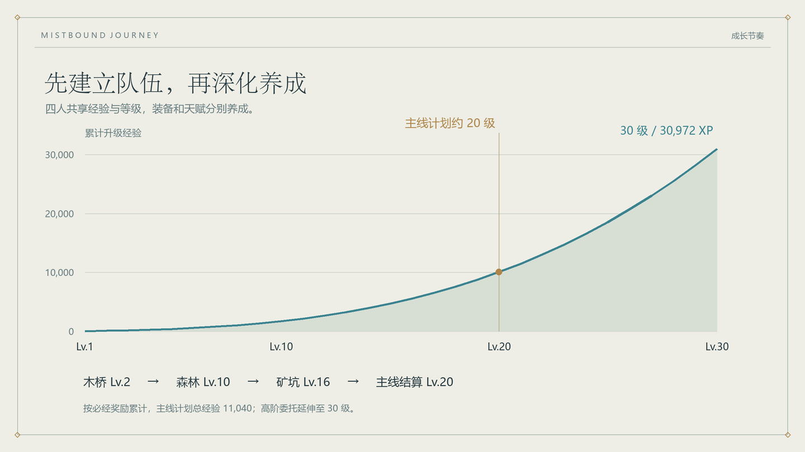
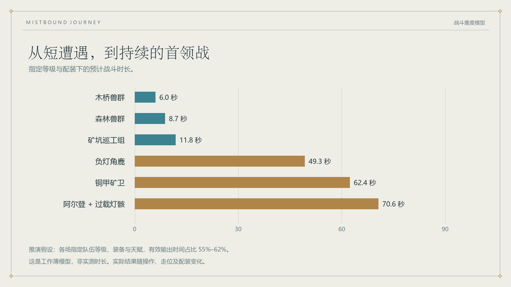

# Mistbound · 雾灯行旅

[简体中文](README.md) · English

**Mistbound is a single-player action RPG about four travelers who fight as one party.** Built in Unreal Engine 5.8, it places pixel-art characters in a 3D world. The travelers plan to go their separate ways when they reach town. Then they pull a courier’s apprentice named Kolin to safety on a bridge. The guild ledger records four tolls and four signatures. Kolin is here. Where are the other three?

**[Download the Windows demo · 658 MiB](https://github.com/NjuCodeNoob/Mistbound/releases/download/v0.2.0-demo/Mistbound-Windows-x64.zip)** · **[Download the editable Excel workbook](https://github.com/NjuCodeNoob/Mistbound/raw/refs/heads/main/balance/Mistbound-Balance.xlsx)** · [Release notes and checksum](https://github.com/NjuCodeNoob/Mistbound/releases/tag/v0.2.0-demo)

I also made Mistbound to explore what working with AI agents looks like over the course of a game, from the first encounter to a public Windows build. I wanted to find out which parts of development agents could speed up and which decisions I needed to make with the game in my hands. [Read the development retrospective](#developing-mistbound-with-ai-agents)

## Four characters on the field, one under your control

Rayne, the swordsman, can dash around an enemy’s flank. Vila, the mage, can lay a fire sigil where an enemy is about to stop. Against a heavy opponent like the mine guardian, Brin can draw its attention and shield the party, then Noah can take over to heal. **When you switch, the character you leave finishes the move you started.** The other three keep fighting, take damage and dodge independently. Hold a party member’s number key at full Resonance to switch straight into their ultimate.

*Mine guardian encounter, recorded at gameplay speed. The orange lines show where an attack will land. A dodge can cancel attack recovery, and you can buffer one skill during the current action.* [View a still from the fight](media/mine-guardian.jpg)

## Five places to retrace a missing caravan

| The valley bridge | Outside the town guild |
| --- | --- |
|  |  |

Follow the lead from the bridge into town and through the woods. The mine’s supply line eventually points toward the Sunken Bell Lighthouse. All five maps can be revisited. Take repeatable guild commissions, buy and sell at shops, open chests or rest at campfires. Press **M** to travel to unlocked map entrances and exits or to campfires you have already visited.

## Try a build in the story and the arena

| Character talents | Arena selection |
| --- | --- |
|  |  |

The party **shares experience from level 1 to 30**, while each character spends talent points and equips gear individually. There are 72 talent nodes across the four characters. The 60 pieces of gear fill four slots for weapons, armor, boots and accessories, and each piece can be upgraded to +5. From the main menu, the arena lets you assemble groups of regular enemies or fight one or two bosses at once. Repeating the same encounter makes it easy to feel the difference a new talent or an upgrade makes.

## How fast should the party grow, and how long should a fight last?

| Shared experience curve | Estimated encounter duration |
| --- | --- |
|  |  |

With only mandatory rewards, the model puts the party near **level 2** after the bridge rescue, **level 10** after restoring the forest lamp and **level 16** at the end of the mine. The main story targets **level 20 at 11,040 cumulative XP**, leaving another ten levels for side activities and repeat encounters.

The combat sheet divides total enemy health by the party’s effective damage per second. It accounts for time spent repositioning and dodging. At the sheet’s preset levels and loadouts, the estimates are **6 seconds** for the bridge wolves, **49 seconds** for the stag boss and **62 seconds** for the mine guardian. Actual times depend on the build and the player.

To try the model, open the worksheet **战斗推演** (combat simulation). On the bridge-wolf row, lower `Uptime` in **K6**, the fraction of the fight spent dealing damage. Watch `Calc_TTK` in **Q6** increase. The sheets **升级曲线** (level curve) and **角色试算** (character calculator) show how XP requirements and equipped stats feed into the model. [Download the full workbook (.xlsx)](https://github.com/NjuCodeNoob/Mistbound/raw/refs/heads/main/balance/Mistbound-Balance.xlsx)

## Developing Mistbound with AI agents

For the opening comic, I reviewed two trial pages and the camera’s path between panels. I changed the panel cuts and several poses, and caught a drawing in which Vila had lost her distinctive short silver hair. That experience shaped the handoff I used elsewhere. I asked an agent to produce one example of the part most likely to go wrong, reviewed it at game size, and approved it before expanding the set. NPC animation, environments and music could then be prepared separately and brought together in one Unreal build.

| Stage | Work agents accelerated on this project | Decisions and checks I would keep with a person |
| --- | --- | --- |
| Art and animation | I supplied the finished NPC walk frames. An agent sliced them by direction, aligned the feet, preserved frame order and imported the sets into Unreal. We also approved one bard spell-circle sample before expanding it into three effects. | Look at the character’s feet while standing still. Enlarge a spell to its in-game radius and check whether the pattern holds up and the enemy warning is still legible. Each of these issues led to revisions after playtests. |
| Levels and interactions | Agents rebuilt five maps from floor plans, checked collision and navigation, and captured an overview and a detail shot for each map. Widening the town stairs also meant checking the ground on both sides and the upper landing. | Walk the route with the actual north–south, 30° gameplay camera. At the bridge I could see Kolin, but the rope frame holding him blocked interaction. A screenshot helped locate the frame. Walking up to it revealed how it blocked the approach. |
| Balance and systems | An agent connected the same progression rules to Excel, equipment, talents and enemy stats. During integration it cross-checked 344 calculations, imported the workbook data into Unreal, exported it again and compared the results. | Choose the level-20 story target and play the fights. At one point allies dodged so often that enemies struggled to hit them. We gave each AI ally a five-second minimum between dodges. How much pressure a group of enemies could exert still needed a fight to judge. |
| Builds and distribution | Agents compiled and packaged a consistent source revision, read back the cooked asset list and verified the executable and balance data. The same checks across five maps made a missing asset traceable by name. | Play through the packaged story and interact when the quest marker says you can. Listen to dialogue-advance and skill sounds. Make a few rapid switches to judge how quickly the camera catches up and how the fast start eases into a stop. |

The two wolves on the opening bridge illustrate the division of work. After the player reaches Kolin, both wolves should rush in along the deck from outside the frame. In a playtest, I saw one appear on the right bank. After the fix, an agent checked the encounter from beside Kolin and from the middle of the bridge. Both wolves needed solid deck underfoot, an offscreen starting position and a continuous route to the party. Those checks can run after the next bridge edit. To judge whether the gap between the two arrivals gives a player enough time to react, I still have to play the encounter.

## Playing the demo

The game and workbook use Simplified Chinese. On a Windows x64 PC with DirectX 12 support, extract the entire ZIP and double-click **`Play-Mistbound.cmd`**. Choose **新的旅途** (New Journey) for the story or **竞技场** (Arena) to go straight into a fight.

| Default action | Input |
| --- | --- |
| Move / fast walk | WASD / hold Shift |
| Basic attack / skill / ultimate | Left mouse button / Q / R |
| Dodge / interact | Space / E |
| Switch / switch into an ultimate | 1–4 / hold the character’s number for 0.5 seconds at full Resonance |
| Party / equipment / inventory / quest journal | C / K / I / J |
| Map / pause | M / Esc |
