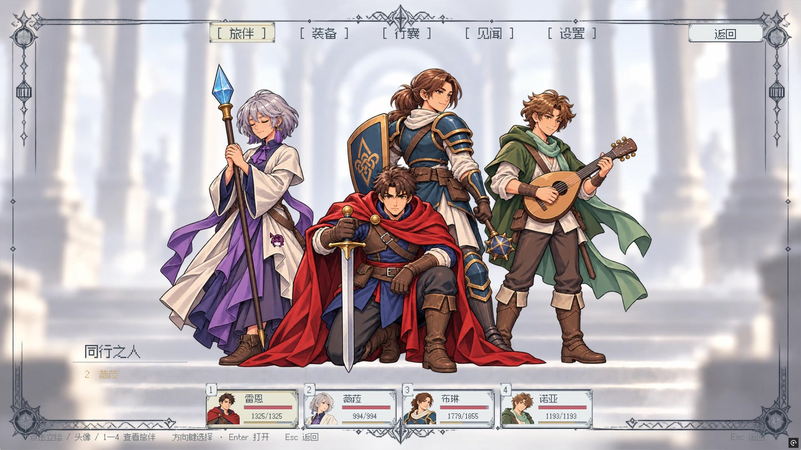
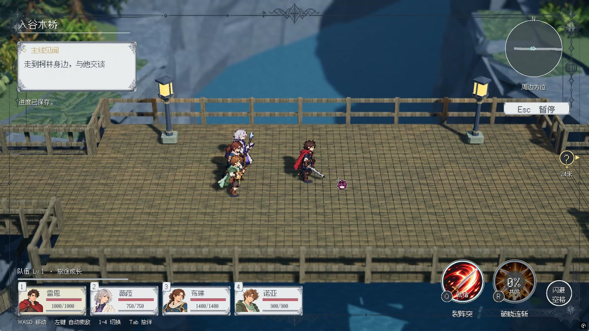
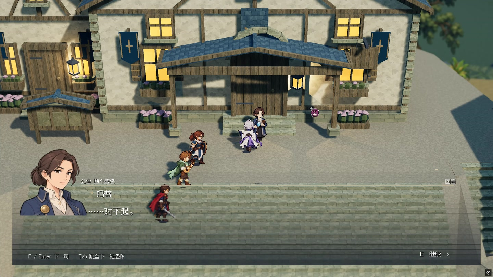
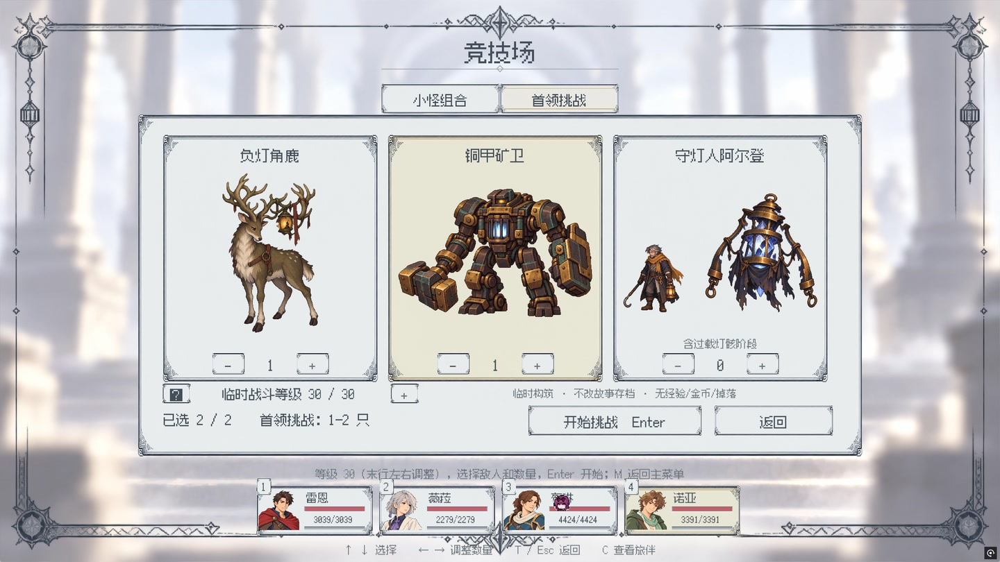
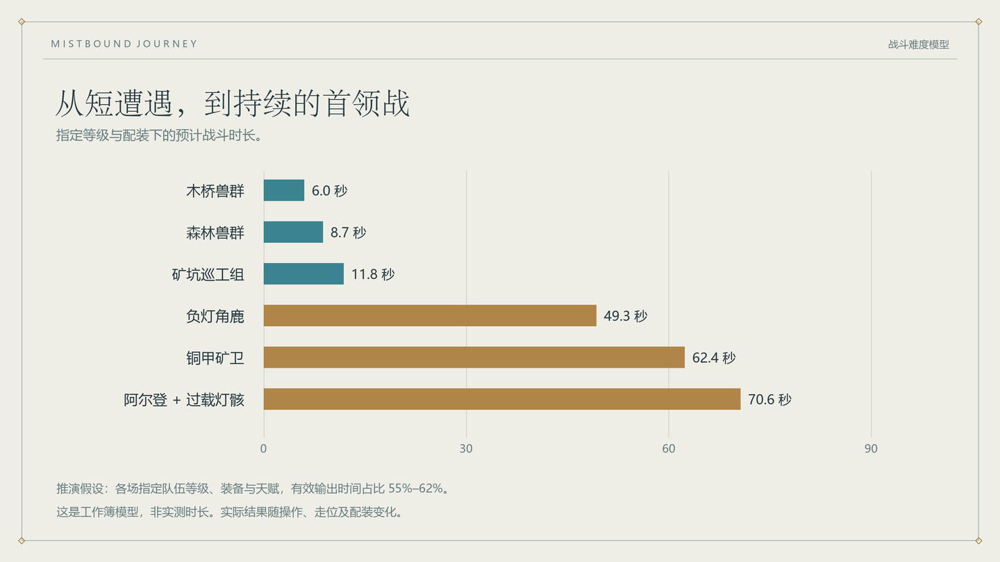

# 雾灯行旅 · Mistbound

**一款可以随时换人的四人小队动作 RPG**，用 Unreal Engine 5.8 把像素角色放进有纵深的 3D 场景。四名旅人原本只约好同路到镇上。雾谷木桥上，他们救下商队学徒柯林。公会账本里留着四份过路费和四个签名，可除了柯林，没人说得清另外三人去了哪里。

**[下载 Windows 试玩版 · 658 MiB](https://github.com/NjuCodeNoob/Mistbound/releases/download/v0.2.0-demo/Mistbound-Windows-x64.zip)**　·　**[下载 Excel 数值工作簿](https://github.com/NjuCodeNoob/Mistbound/raw/refs/heads/main/balance/Mistbound-Balance.xlsx)**　·　[版本说明与文件校验](https://github.com/NjuCodeNoob/Mistbound/releases/tag/v0.2.0-demo)

## 四个人同时在场，一次操控一人

雷恩能用突进抢到敌人侧面，薇菈的焰纹阵适合放在敌人即将停下的位置。遇到矿卫这样的重型敌人，可以先让布琳嘲讽、给队友套盾，再切诺亚回复生命。**换人时，上一位角色会把手里的招式放完**，另外三人也会自主攻击、受伤和闪避。长按已蓄满共鸣的队员数字键，可以直接换人接大招。

*铜甲矿卫战，原速实机片段。橙线标出即将受击的区域。闪避可以取消攻击后摇，进攻时也可以提前输入下一项技能。* [查看战斗静帧](media/mine-guardian.jpg)

## 一桩失踪案，五张可以重返的地图

| 入谷木桥 | 镇上的公会 |
| --- | --- |
|  |  |

顺着桥上的线索进镇，穿过林地，循着矿坑里的输送线走到沉钟灯塔。沿途能接取公会的重复委托、在商店买卖、开启宝箱或在营火处休整。按 **M** 可以传送到已解锁的地图出入口和到访过的营火。

## 把同一套配装放进两种战斗

| 角色天赋 | 自选竞技场 |
| --- | --- |
|  |  |

四人**共享 1–30 级的队伍经验**，各自分配天赋、穿戴装备。全队共 72 个天赋节点，60 件装备分属武器、防具、靴子和饰品四个槽位，最高可强化到 +5。主菜单的竞技场可以组合多只小怪，或同时挑战 1–2 名首领。在相同对手下换一套配装，就能直接感受一次强化或天赋选择的影响。

## 一路升几级，一场打多久

| 共享经验曲线 | 不同遭遇的预计用时 |
| --- | --- |
|  |  |

按必经奖励估算，木桥救援后队伍约 **2 级**，修复森林灯时约 **10 级**，矿坑结束约 **16 级**。主线结算预计为 **20 级、累计 11,040 经验**，余下十级为支线和重复挑战留出成长空间。

战斗表用敌方总生命除以全队的有效秒伤。把走位、闪避留下的输出空档计入后，在表内预设的等级和配装下，木桥兽群约 **6 秒**，负灯角鹿约 **49 秒**，铜甲矿卫约 **62 秒**。这些时间是模型推演值，玩家的配装与操作会改变实际用时。

工作簿保留了可编辑公式。想看难度如何变化，可以打开「战斗推演」，在木桥兽群那一行调低 `Uptime`（K6，能持续输出的时间占比），观察 `Calc_TTK`（Q6，预计击败用时）如何增加。「升级曲线」和「角色试算」还可以对照经验需求与配装后的角色属性。[下载完整工作簿（.xlsx）](https://github.com/NjuCodeNoob/Mistbound/raw/refs/heads/main/balance/Mistbound-Balance.xlsx)

## 开始游玩

在支持 DirectX 12 的 Windows x64 电脑上，完整解压试玩包，打开文件夹，双击 **`Play-Mistbound.cmd`**。选择「新的旅途」进入故事，或从主菜单选择「竞技场」直接试战。

| 默认操作 | 按键 |
| --- | --- |
| 移动 / 快走 | WASD / 按住 Shift |
| 普攻 / 小技能 / 大招 | 鼠标左键 / Q / R |
| 闪避 / 交互 | 空格 / E |
| 切换旅伴 / 换人接大招 | 1–4 / 共鸣蓄满后按住对应数字 0.5 秒 |
| 角色 / 装备 / 行囊 / 见闻 | C / K / I / J |
| 地图 / 暂停 | M / Esc |
